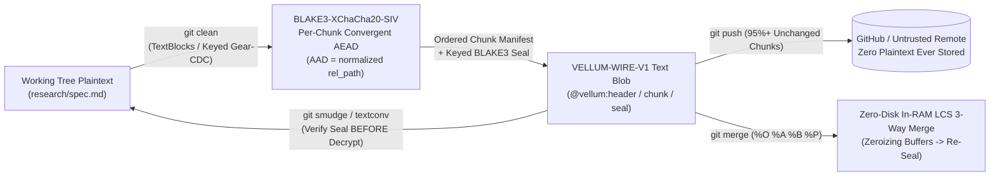

# Vellum (`vellum` v0.1.0)

[](https://github.com/tsiscoe/Vellum/actions/workflows/ci.yml)
[](LICENSE)
[](Cargo.toml)
[![Safety: #![forbid(unsafe_code)]](https://img.shields.io/badge/unsafe-forbid-success.svg)](src/lib.rs)

**Vellum** (`vellum`) is a pure-Rust (`#![forbid(unsafe_code)]`) **Chunk-Convergent `BLAKE3-XChaCha20-SIV` Git Clean/Smudge Filter, Zero-Disk In-RAM 3-Way Merge Driver, and Merkle-Sealed Diff Engine**.

---

## Why Does Vellum Exist?

Most encrypted Git tools treat your repository like an uncooperative brick. You use `git-crypt` or a full-file cipher, fix a single typo in paragraph 14 of a forty-page research spec, and watch 100% of the ciphertext mutate into unreadable binary porridge. Congratulations: you've just lobotomized `git diff`, thrown Git's packfile delta compression down a well, and guaranteed that two teammates editing totally different chapters will spend Friday afternoon resolving an unmergeable binary collision.

**Vellum** splits the difference without handing your plaintext to a cloud host or watering down the cryptography:

1. **Deterministic Keyed Chunking (`TextBlocks` + `BinaryCdc`):** UTF-8 files split along semantic paragraph and Markdown heading boundaries while preserving every byte and line ending; binary artifacts fall back to a keyed 64-bit Gear rolling-hash CDC (`BLAKE3 XOF(cdc_key)`) so insertion shifts resynchronize cleanly instead of cascading across the entire file.
2. **RFC 5297-Style `BLAKE3-XChaCha20-SIV` Per Chunk:** Every chunk derives a synthetic IV and per-chunk encryption key from `(siv_key, enc_key, normalized_rel_path, chunk_plaintext)`. Leave 19 paragraphs untouched while rewriting paragraph 7, and 19 out of 20 `@vellum:chunk:v1` ciphertext lines stay **byte-for-byte identical** (`95%` delta reuse).
3. **Full-File Merkle Seal (`@vellum:seal:v1`):** Deterministic encryption alone has a classic trap—an attacker with write access to Git can reorder chunks, delete a safety paragraph, or transplant valid ciphertext blocks from another file. Vellum appends a keyed `BLAKE3` seal authenticating `(rel_path, mode, chunk_count, ordered_chunk_digests)` and refuses decryption before touching a single cipher block if anything moved.
4. **Zero-Disk In-RAM 3-Way Merge (`vellum merge`):** Standard Git merges fail on ciphertext. Vellum acts as Git's custom `merge` driver (`%O %A %B %P`), decrypts all three revisions strictly inside `Zeroizing` RAM, runs an LCS 3-way line merge, and writes back a freshly Merkle-sealed `VELLUM-WIRE-V1` file without ever dropping plaintext onto disk.



---

## Cryptographic & Defense-in-Depth Spec Sheet

| Layer | Primitive | What It Actually Does |
| :--- | :--- | :--- |
| **Memory & Type Safety** | `#![forbid(unsafe_code)]` + `Zeroizing` | Zero `unsafe` blocks anywhere in the crate; keys, decrypted chunks, and 3-way merge text live in `Zeroizing` memory and wipe on drop. |
| **Key Hierarchy** | `RepoMasterKey` (`32B`) + `HKDF-SHA256` | Expands domain-separated 256-bit keys: `cdc_key`, `siv_key`, `enc_key`, `seal_key`. |
| **Convergent Chunk AEAD** | `BLAKE3` Keyed SIV + `XChaCha20-Poly1305` (192-bit nonce) | Binds both chunk SIV and `AAD` to `normalized_rel_path`; decrypt verifies plaintext recomputes the exact wire nonce and `chunk_id`. |
| **Merkle File Seal** | `@vellum:seal:v1` (`BLAKE3` keyed MAC) + `path_mac` | Commits to normalized path, chunker mode, chunk count, and ordered chunk digests—defeating block reordering, deletion, and cross-file swaps. |
| **Custody Vault (`vellum.db`)** | `Argon2id` (`64 MiB, t=3, p=4`) + `XChaCha20-Poly1305` + `rusqlite 0.42.0` | Encrypts scoped repo keys and every `seal_audit_log` path/metric row inside `BEGIN IMMEDIATE` WAL (`PRAGMA secure_delete = ON`, fail-closed `icacls` / `0600`). |
| **Terminal Sanitization** | `sanitize_terminal_str` (`CWE-150`) | Strips C0/C1 control bytes and ANSI/OSC escape sequences before rendering repository paths inside `vellum tui`. |

---

## Quick Start

### 1. Build from Source

```bash
git clone https://github.com/tsiscoe/Vellum.git
cd Vellum
cargo build --release
```

### 2. Initialize Your Scoped Vault (`vellum init`)

```bash
# Initialize Your Scoped Vault (raw key redacted on stdout unless --reveal is passed)
vellum --keyring init --scope default --export-key ./vellum-default.key

# Print exact .gitattributes and .git/config wiring (strict [A-Za-z0-9_-] scope validation)
vellum git-config --scope default
```

### 3. Clean, Smudge, Diff & 3-Way Merge (`clean` / `smudge` / `diff` / `merge`)

```bash
# Clean a plaintext file into Merkle-sealed VELLUM-WIRE-V1 (idempotent if already sealed)
vellum clean --path docs/spec.md --key ./vellum-default.key -i ./spec.md -o ./spec.vellum

# Inspect chunk reuse & decrypted unified diff strictly in memory
vellum diff ./spec-v1.vellum ./spec-v2.vellum --path docs/spec.md --key ./vellum-default.key

# Zero-disk in-RAM 3-way merge (compatible with Git %O %A %B %P merge drivers)
vellum merge --base ./base.vellum --ours ./ours.vellum --theirs ./theirs.vellum --path docs/spec.md --key ./vellum-default.key

# Verify every VELLUM-WIRE-V1 seal across a directory tree
vellum verify-tree --dir . --key ./vellum-default.key

# Inspect scoped keys, wireframe chunks, and Merkle audit log in Ratatui
vellum --keyring tui --file ./spec.vellum
```

---

## Verification & Adversarial Test Suite

```bash
cargo fmt --all -- --check
cargo clippy --all-targets -- -D warnings
cargo test
```

---

## License

Licensed under the [MIT License](LICENSE). Because storing confidential research drafts in plaintext on someone else's cloud Git server is just open-source philanthropy you didn't mean to sign up for.
