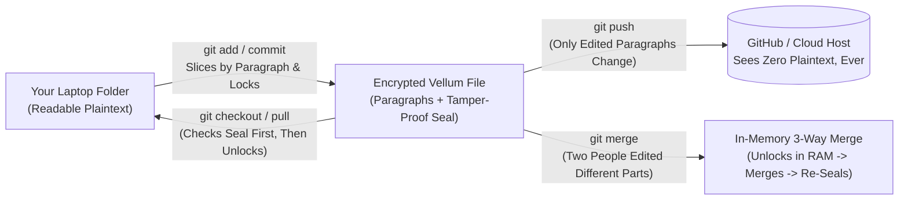

# Vellum (`vellum` v0.1.0)

[](https://github.com/tsiscoe/Vellum/actions/workflows/ci.yml)
[](LICENSE)
[](Cargo.toml)
[![Safety: #![forbid(unsafe_code)]](https://img.shields.io/badge/unsafe-forbid-success.svg)](src/lib.rs)

**Vellum** encrypts your private notes, research drafts, and config files inside Git without turning your repository into an unmergeable binary brick—only the paragraphs you actually edit re-encrypt, Git merges happen purely in memory, and GitHub never sees a single word of your plaintext. Pure safe Rust (`#![forbid(unsafe_code)]`).

---

## What's the Problem? (And Why Most "Encrypted Git" Tools Are a Joke)

Putting confidential work into a normal cloud Git repository is basically mailing your diary on the back of a postcard and hoping the postie doesn't fancy a read. Even a "private" repo just means your trade secrets, half-finished papers, and embarrassing post-mortems are sitting unencrypted on somebody else's server farm, one misconfigured permission, stolen OAuth token, or curious cloud contractor away from becoming public performance art.

So people reach for traditional Git encryption tools like `git-crypt`—which solve one problem by setting fire to everything else Git is actually good at.

Normal file encryption treats a forty-page document like a breeze block. Fix one typo on page 14—change "teh" to "the"—and the *entire encrypted file* scrambles from top to bottom into unrecognizable static. Suddenly:
- **`git diff` goes completely blind.** Git has no idea whether you fixed a comma or replaced the whole manual with a ransom note.
- **Your repository bloats like a drowned badger** because Git has to store a brand-new copy of the whole scrambled file on every single commit.
- **Collaboration dies on the spot.** If you edit Chapter 1 and your colleague edits Chapter 12 on another branch, Git throws a massive binary merge tantrum and tells one of you to delete your afternoon's work. It is the software equivalent of welding your filing cabinet shut so burglars can't read the folders, and then having to blowtorch the hinges off every time you want to add a sticky note.

---

## How Vellum Fixes It (In Plain English)

**Vellum** sits quietly between your working folder and Git so you get real encryption on the remote server *without* lobotomizing Git's brain:

1. **It slices your files into paragraphs, not soup.** When you save a document, Vellum cuts it cleanly along natural paragraph and heading breaks (or smart rolling chunks for binary files). On your own laptop, you read and edit normal text like a normal human being.
2. **Change one sentence, only that paragraph changes.** Each paragraph is locked using a key tied to its exact text and file path. Leave 19 paragraphs alone and rewrite paragraph 7? Nineteen of the twenty encrypted lines stay *identical*. Git sees a tiny, surgical change instead of a nuclear blast.
3. **A tamper-proof wax seal stops cut-and-paste tricks.** If you just encrypt paragraphs individually, a sneaky attacker with repo access could swap two paragraphs around, quietly delete a warning section, or paste an encrypted chunk from another file into yours. Before Vellum ever unlocks a file, it checks a cryptographic wax seal covering the file's exact path, total paragraph count, and exact paragraph order. Swap two lines or rename the file behind its back, and Vellum tells you to get lost before decrypting a single byte.
4. **It merges branches in RAM without touching your hard drive.** When two branches edit different parts of the same encrypted file, Git hands all three encrypted versions to Vellum. Vellum unlocks them strictly inside self-wiping memory, stitches the edits together cleanly, re-seals the result, and hands the encrypted file back to Git. Plaintext merge scratch files never touch your disk.



---

## What's Under the Bonnet (For the Paranoid)

You don't need a cryptography degree to use Vellum, though if you *do* have one and enjoy reading threat models for fun, the gory mathematical details live in [**ARCHITECTURE.md**](ARCHITECTURE.md). Here is the plain-spoken version:

| Guardrail | What's Inside | Why You Care |
| :--- | :--- | :--- |
| **Memory Safety** | 100% Safe Rust (`#![forbid(unsafe_code)]`) + Self-Wiping RAM | No C libraries to buffer-overflow, and keys plus unlocked text wipe themselves from memory the microsecond Vellum finishes with them. |
| **Paragraph Locking** | `BLAKE3` Keyed SIV + `XChaCha20-Poly1305` | Modern industrial-grade encryption tied to the file's path, so identical paragraphs in *different* files still look completely different on GitHub. |
| **Tamper-Proof File Seal** | Full-File Keyed `BLAKE3` Merkle Seal | Locks the file name, chunk count, and exact paragraph order. Nobody can delete a paragraph or shuffle chapters undetected. |
| **Local Key Vault** | `Argon2id` + `XChaCha20-Poly1305` SQLite Vault | Locks your repo keys and local audit trail inside an owner-only folder on your machine, unlocked via your OS keyring or passphrase. |
| **Terminal Booby-Trap Shield** | ANSI / Control-Byte Scrubber | Strips hidden terminal escape codes out of dodgy filenames so inspecting a hostile repo in `vellum tui` can't hijack your screen. |

---

## Quick Start (Two Minutes, Zero Drama)

### 1. Build It

```bash
git clone https://github.com/tsiscoe/Vellum.git
cd Vellum
cargo build --locked --release
cargo install --locked --path .
```

### 2. Set Up Your Vault & Git Wiring

```bash
# Create your local encrypted vault and generate a key for the "default" scope
# (Vellum hides the raw key from your terminal scrollback unless you pass --reveal)
vellum --keyring init --scope default

# Print the exact lines to paste into .gitattributes and .git/config
vellum --keyring git-config --scope default
```

### 3. Lock, Diff, Merge & Inspect

```bash
# Lock a plaintext file into a sealed .vellum wireframe
vellum --keyring clean --path docs/spec.md -i ./spec.md -o ./spec.vellum

# Compare two encrypted versions purely in memory (shows paragraph reuse + text diff)
vellum --keyring diff ./spec-v1.vellum ./spec-v2.vellum --path docs/spec.md

# Run a 3-way merge across encrypted branches without writing plaintext temp files
vellum --keyring merge --base ./base.vellum --ours ./ours.vellum --theirs ./theirs.vellum --path docs/spec.md

# Check staged Git files against your own trusted list of files that MUST be encrypted
vellum --keyring verify-tree --staged --manifest /trusted/protected-paths.json

# Open the interactive terminal dashboard to inspect keys, chunks, and audit history
vellum --keyring tui --file ./spec.vellum
```

---

## Honest Trade-Offs (No Snake Oil)

- **GitHub can tell *how many* paragraphs changed, just not *what they say*.** That is the unavoidable bargain of paragraph-by-paragraph encryption: if you edit 1 paragraph out of 20, anyone watching the repo can see 19 chunks stayed put and 1 chunk changed—and they can see the rough size of each paragraph. They still get zero plaintext.
- **Your own laptop still has the unlocked files while you work on them.** Checking out a branch writes readable files into your local working folder, and running `vellum diff` prints readable differences to your screen. Vellum protects you from untrusted Git servers, not from leaving your unlocked laptop in a Wetherspoons. See [**INSTALL.md**](INSTALL.md) for vault permissions, pre-push manifest checks, and audit checkpoints.

---

## Running the Test Suite

```bash
cargo fmt --all -- --check
cargo clippy --locked --all-targets -- -D warnings
cargo test --locked
```

---

## Documentation Map

- [**INSTALL.md**](INSTALL.md) — Step-by-step setup, Git wiring, pre-push safety checks, and vault backups.
- [**ARCHITECTURE.md**](ARCHITECTURE.md) — How the chunker, seals, 3-way RAM merger, and cryptography actually work.
- [**CONTRIBUTING.md**](CONTRIBUTING.md) — House rules for pull requests and security gates.
- [**CHANGELOG.md**](CHANGELOG.md) — What shipped and what got bolted down.

---

## License

Licensed under the [MIT License](LICENSE). Because leaving confidential drafts unencrypted on somebody else's cloud Git server isn't "moving fast"—it's donating your intellectual property to strangers with better Wi-Fi.
